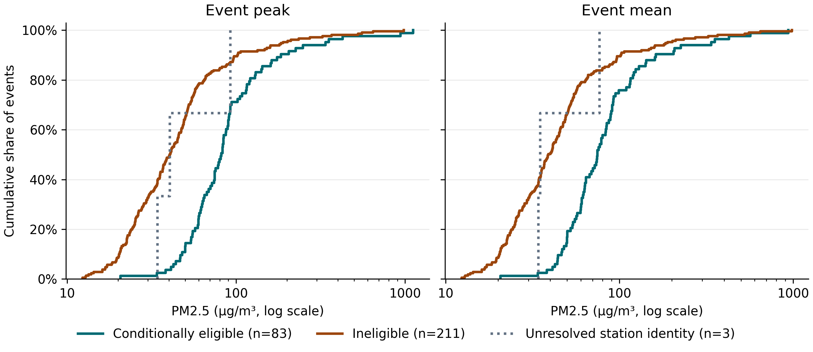
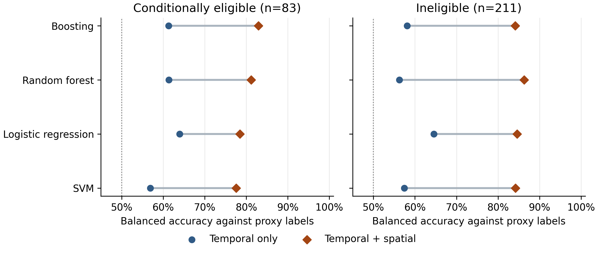

# Trigger eligibility in the frozen WP03 cohort

## Eligibility summary

| Trigger eligibility | Events | Share of cohort |
| --- | --- | --- |
| Conditionally eligible | 83 | 27.9% |
| Ineligible | 211 | 71.0% |
| Unresolved station identity | 3 | 1.0% |
| All held-out events | 297 | 100.0% |

## Eligibility by proxy class

| Proxy class | Conditionally eligible | Ineligible | Unresolved | Total | Eligible share of class |
| --- | --- | --- | --- | --- | --- |
| real | 55 | 142 | 3 | 200 | 27.5% |
| fake | 28 | 69 | 0 | 97 | 28.9% |

Concentrations are computed from frozen WP03 hourly event summaries. The trigger uses a latest raw point.

## Frozen model performance by trigger eligibility

| Trigger eligibility | Model | Features | Events | Balanced accuracy | Precision | Recall | F1 |
| --- | --- | --- | --- | --- | --- | --- | --- |
| Conditionally eligible | boosting | Temporal only | 83 | 61.3% | 74.5% | 69.1% | 71.7% |
| Conditionally eligible | boosting | Temporal + spatial | 83 | 83.0% | 87.7% | 90.9% | 89.3% |
| Conditionally eligible | forest | Temporal only | 83 | 61.4% | 74.1% | 72.7% | 73.4% |
| Conditionally eligible | forest | Temporal + spatial | 83 | 81.2% | 86.2% | 90.9% | 88.5% |
| Conditionally eligible | logistic | Temporal only | 83 | 64.0% | 77.1% | 67.3% | 71.8% |
| Conditionally eligible | logistic | Temporal + spatial | 83 | 78.5% | 84.5% | 89.1% | 86.7% |
| Conditionally eligible | svm | Temporal only | 83 | 56.9% | 70.9% | 70.9% | 70.9% |
| Conditionally eligible | svm | Temporal + spatial | 83 | 77.6% | 84.2% | 87.3% | 85.7% |
| Ineligible | boosting | Temporal only | 211 | 58.1% | 73.4% | 64.1% | 68.4% |
| Ineligible | boosting | Temporal + spatial | 211 | 84.2% | 88.6% | 93.0% | 90.7% |
| Ineligible | forest | Temporal only | 211 | 56.2% | 71.4% | 70.4% | 70.9% |
| Ineligible | forest | Temporal + spatial | 211 | 86.3% | 89.5% | 95.8% | 92.5% |
| Ineligible | logistic | Temporal only | 211 | 64.6% | 78.0% | 69.7% | 73.6% |
| Ineligible | logistic | Temporal + spatial | 211 | 84.6% | 90.6% | 88.0% | 89.3% |
| Ineligible | svm | Temporal only | 211 | 57.4% | 72.8% | 64.1% | 68.2% |
| Ineligible | svm | Temporal + spatial | 211 | 84.2% | 89.0% | 91.5% | 90.3% |

## Spatial feature change within eligible events

Temporal + spatial minus temporal only, in percentage points. Both arms use the same 83 events.

| Model | Balanced accuracy | Precision | Recall | F1 |
| --- | --- | --- | --- | --- |
| boosting | +21.6 | +13.2 | +21.8 | +17.6 |
| forest | +19.8 | +12.1 | +18.2 | +15.1 |
| logistic | +14.5 | +7.4 | +21.8 | +14.9 |
| svm | +20.7 | +13.3 | +16.4 | +14.8 |

Proxy-real is the positive class. The three unresolved cases remain in the descriptive cohort. Trigger eligibility describes entry into a conditional investigation. These model scores measure agreement with proxy labels, and spatial evidence also contributes to those labels. The subgroup comparisons are descriptive and include no agent decisions.
